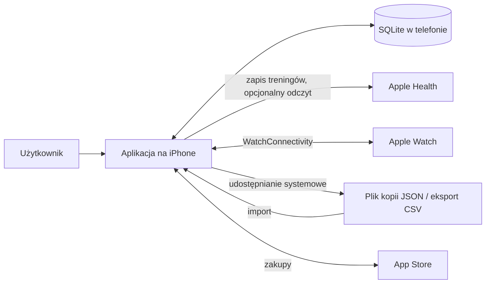

# Trening 🏋️

<!-- gen:badges-ci -->
[](https://github.com/lkarwowski494/trening/actions/workflows/tests.yml)
[](https://github.com/lkarwowski494/trening/actions/workflows/e2e-ios.yml)
[](https://github.com/lkarwowski494/trening/actions/workflows/ios-unsigned.yml)
<!-- /gen:badges-ci -->

<!-- gen:badges-ver -->
[](docs/18-przekazanie.md)
[](https://developer.apple.com/ios/)
[](https://developer.apple.com/watchos/)
[](https://expo.dev/)
[](https://reactnative.dev/)
[](https://www.typescriptlang.org/)
[](https://www.sqlite.org/)
[](docs/16-jezyki-i-marka.md)
[-4738-brightgreen?style=flat)](docs/19-macierz-testow.md)
[](docs/37-katalog-przeplywow.md)
<!-- /gen:badges-ver -->

> **Dziennik treningu siłowego na iPhone'a i Apple Watch — prywatny, działający bez internetu, bez konta.**

Trening to natywna aplikacja (Expo / React Native, TypeScript) do zapisywania treningów siłowych i cardio: szablony i trening z kartą bieżącej serii,
przerwy z powiadomieniem i Live Activity, plan tygodnia z kalendarzem, postępy z wykresami i rekordami oraz opcjonalny zapis do Apple Health.
Powstaje w ekosystemie Apps4Brew. Dane zostają w telefonie (SQLite); stan prac, decyzje właściciela i dokumentacja: [`docs/`](docs/) (po polsku),
zasady pracy nad kodem: [`CLAUDE.md`](CLAUDE.md).

---

## 🌟 Zasady produktowe

- **Offline-first, dane tylko w telefonie.** Zapis w lokalnej bazie SQLite; aplikacja nie wykonuje żadnych wywołań sieciowych, a test w repozytorium tego pilnuje
  (`tests/public-repo.test.ts`). Kierunek rozwoju funkcji offline: [`docs/21-roadmapa-offline.md`](docs/21-roadmapa-offline.md).
- **Bez konta, reklam, analityki i śledzenia.** Brak ekranu logowania; zasady opisuje [polityka prywatności](site/privacy.html), a decyzje o deklaracji
  prywatności w sklepie — [`docs/18-przekazanie.md`](docs/18-przekazanie.md).
- **Dane należą do użytkownika.** Kopia zapasowa w pliku JSON, eksport i import CSV, kopia bezpieczeństwa przed każdym importem i przed czyszczeniem danych
  ([`docs/12-edycja-treningow.md`](docs/12-edycja-treningow.md), sekcja „Import danych” niżej).
- **Szablony ustawia użytkownik.** Aplikacja nie tworzy ich sama; generator szablonu i planu działa wyłącznie na wyraźne polecenie, pokazuje podgląd przed zapisem
  i opiera się na regułach z potwierdzonych źródeł ([`docs/24-generator-i-plany.md`](docs/24-generator-i-plany.md)).
- **Merytoryczne podstawy.** Liczby i zalecenia mają przeczytane źródła według hierarchii z [`CLAUDE.md`](CLAUDE.md); reguły oparte na jednym źródle są tak oznaczone.
  Aplikacja nie udziela porad medycznych (ból, kontuzje, choroby — odsyła do specjalisty). Wnioski i źródła: [`docs/research/`](docs/research/).
- **Wiele języków, jedna logika.** Interfejs, jednostki (kg i lb), motyw jasny i ciemny ([`docs/16-jezyki-i-marka.md`](docs/16-jezyki-i-marka.md)); liczba języków w tabeli niżej.
- **Tylko własne treści.** Własne teksty i grafiki; bez nazw innych aplikacji w kodzie, tekstach i opisie sklepu (zasada w [`CLAUDE.md`](CLAUDE.md), pilnuje jej `tests/forbidden-names.test.ts`).

## 📊 Projekt w liczbach

Wszystkie liczby w tej sekcji (i odznaki u góry) generuje [`scripts/readme.mjs`](scripts/readme.mjs) z kodu i dokumentów generowanych; ręcznie nie wpisujemy żadnej.
Liczba przypadków testowych jest liczona **statycznie** (bez uruchamiania testów), dlatego nazywamy ją tak, a nie „wynikiem przebiegu”; wynik przebiegu pokazuje odznaka stanu workflowu.

<!-- gen:stats -->
| Miara | Wartość | Źródło |
|---|---|---|
| Wersja aplikacji | 0.20.0 | `app.json`, `package.json` (docs/18) |
| Minimalny iOS | 16.4 | baza Expo (`ExpoModulesCore.podspec`); tylko iPhone |
| Minimalny watchOS (Apple Watch) | 10.0 | `targets/watch-app/expo-target.config.js`, docs/35-zegarek-apple.md |
| Platforma | Expo SDK 57 · React Native 0.86 · React 19.2 · TypeScript 6.0 | `package.json` |
| Języki interfejsu | 35 | `lib/i18n.ts` (`LANGS`), `app.json`, docs/16-jezyki-i-marka.md |
| Ćwiczenia w bibliotece | 709 | `lib/seed.ts`, `lib/catalog.generated.ts`, docs/10-miejsca-i-sprzet.md |
| Ekrany (trasy w `app/`) | 32 (z testem: 32) | docs/19-macierz-testow.md |
| Elementy UI (przyciski, pola, przełączniki) | 343 (z testem: 343) | docs/19-macierz-testow.md |
| Komunikaty i teksty | 1100 (z testem: 1100) | docs/19-macierz-testow.md |
| Funkcje biblioteki `lib/` | 903 (z testem: 903) | docs/19-macierz-testow.md |
| Wymiary (listy wartości i typy-unie) | 113 (z testem: 113) | docs/19-macierz-testow.md |
| Pliki testów Jest | 401 | `tests/*.test.ts(x)`, docs/09-plan-testow.md |
| Przypadki testowe (statycznie) | 4738 | wywołania `test(` i `it(` w kodzie testów, bez uruchamiania; `test.each` i pętla liczą się raz, więc liczba rzeczywistych przebiegów jest większa |
| Przepływy użytkownika w katalogu E2E | 152 (Maestro: 125, Maestro, eksperymentalne: 4, Jest: 10, lista kontrolna wydania (telefon): 13) | docs/37-katalog-przeplywow.md |
| Scenariusze Maestro | 45 (w głównym przebiegu: 42, eksperymentalne: 3) | `.maestro/`, docs/38-przeplywy-i-luki-e2e.md |
<!-- /gen:stats -->

## 📱 Moduły i ekrany

| Moduł | Co robi | Stan | Dokumenty |
|---|---|---|---|
| **Trening** | Start z szablonu lub pusty trening, karta bieżącej serii, typy serii, supersety, zamiana ćwiczenia w trakcie, przerwy z powiadomieniem i Live Activity, tryb skupiony na serii | w aplikacji | [`docs/14-e2-specyfikacja.md`](docs/14-e2-specyfikacja.md), [`docs/17-szablon-jak-trening.md`](docs/17-szablon-jak-trening.md) |
| **Szablony i ćwiczenia** | Własne szablony, biblioteka ćwiczeń z wskazówkami techniki i sylwetkami, miejsca treningu i sprzęt, gumy oporowe | w aplikacji | [`docs/10-miejsca-i-sprzet.md`](docs/10-miejsca-i-sprzet.md), [`docs/11-baza-wiedzy.md`](docs/11-baza-wiedzy.md) |
| **Plan i kalendarz** | Plan tygodnia, kilka planów, przesunięcia, deload jako propozycja do zatwierdzenia, generator szablonów i planu na polecenie, „Dostosuj do miejsca” | w aplikacji | [`docs/24-generator-i-plany.md`](docs/24-generator-i-plany.md), [`docs/33-dostosowanie-do-miejsca-spec.md`](docs/33-dostosowanie-do-miejsca-spec.md) |
| **Historia** | Lista treningów, edycja i dopisanie treningu wstecz, kopia i przywracanie | w aplikacji | [`docs/12-edycja-treningow.md`](docs/12-edycja-treningow.md) |
| **Postępy** | Wykresy, rekordy, szacowany maksymalny ciężar (wzór Epleya), mapa mięśni, „Strażnik progresji”, podsumowanie tygodnia i miesiąca, masa ciała | w aplikacji | [`docs/research/`](docs/research/) |
| **Apple Health** | Zapis zakończonych treningów; odczyt kroków, treningów, tętna i kalorii tylko do wyświetlenia, domyślnie wyłączony, poza kopią zapasową | w aplikacji (odczyt opcjonalny) | [`docs/28-healthkit-etap0.md`](docs/28-healthkit-etap0.md), [`docs/29-zdrowie-odczyt-spec.md`](docs/29-zdrowie-odczyt-spec.md) |
| **Apple Watch** | Zegarek tylko wyświetla bieżącą serię i przerwę oraz przyjmuje zdarzenia „zrobione / inaczej / pomiń / cofnij”; edycja wyłącznie w telefonie | w gałęzi wydania, sprawdzany tylko na symulatorze | [`docs/35-zegarki.md`](docs/35-zegarki.md), [`docs/35-zegarek-apple.md`](docs/35-zegarek-apple.md) |
| **Głos w słuchawkach** | Komunikaty głosowe w przerwie, ustawienia głosu | w gałęzi wydania | [`docs/36-glos.md`](docs/36-glos.md) |
| **Dostęp i zakupy** | Pełna wersja, okres próbny, limit treningów na żywo | wdrożone za przełącznikiem (stan w sekcji „Model cenowy”) | [`docs/27-subskrypcja-spec.md`](docs/27-subskrypcja-spec.md), [`docs/30-storekit-etap0.md`](docs/30-storekit-etap0.md) |
| **Pomoc i opinie** | Przewodnik, „Co nowego”, „Napisz do nas”, prośba o ocenę w sklepie | w aplikacji | [`docs/26-prosba-o-ocene.md`](docs/26-prosba-o-ocene.md), [`docs/34-wsparcie-i-opinie.md`](docs/34-wsparcie-i-opinie.md) |
| **Języki, wygląd, jednostki** | Wybór języka, motyw jasny i ciemny, kg i lb | w aplikacji | [`docs/16-jezyki-i-marka.md`](docs/16-jezyki-i-marka.md) |

Przepływy między ekranami i wzorce interakcji: [`docs/22-przeplywy-i-nawigacja.md`](docs/22-przeplywy-i-nawigacja.md), [`docs/32-wzorce-interakcji.md`](docs/32-wzorce-interakcji.md).

## 💶 Model cenowy

Założenie produktowe: cena miesięczna poniżej ceny espresso, roczna i dożywotnia w stałych proporcjach do niej (decyzje właściciela i wyjątki dla poszczególnych krajów:
[`docs/18-przekazanie.md`](docs/18-przekazanie.md); wcześniejsza specyfikacja: [`docs/27-subskrypcja-spec.md`](docs/27-subskrypcja-spec.md), [`docs/15-app-store.md`](docs/15-app-store.md)).
Aplikacja nie ma cen wpisanych na sztywno — wyświetla to, co zwraca App Store (`lib/products.ts`). Poniższa tabela jest generowana z pliku konfiguracji sklepu i pokazuje ceny
**referencyjne w dolarach**; ceny w innych walutach ustawia się w App Store Connect.

<!-- gen:pricing -->
Stan przełącznika płatności: `PAYWALL.ENABLED` = `false` (`lib/access.ts`) — wszystkie funkcje są dostępne bez limitu, dopóki właściciel nie włączy płatności (zmiana jednej wartości i wydanie).

| Plan | Rodzaj | Cena referencyjna (USD, plik `store/Trening.storekit`) |
|---|---|---|
| Miesięczny | subskrypcja odnawiana co miesiąc, pierwsze 14 dni bezpłatnie | 0.99 |
| Roczny | subskrypcja odnawiana co rok, pierwsze 14 dni bezpłatnie | 6.99 |
| Dożywotni | zakup jednorazowy | 14.99 |

Okres próbny w kodzie: 14 dni (`TRIAL_DAYS`, `lib/products.ts`); karencja offline dla zapamiętanego dostępu: 7 dni (`OFFLINE_GRACE_DAYS`).
<!-- /gen:pricing -->

Płatne funkcje zależą od jednego przełącznika w jednym module, więc przejście na model darmowy to zmiana jednej wartości i wydanie.

## 🔄 Przepływ danych



- **Źródłem prawdy jest stan w SQLite** (`lib/store.ts` jako fasada; wersja schematu `schemaVersion` w `lib/seed.ts`, migracje w `migrate()` w `lib/state/migrate.ts`).
  Zapis, restart i odczyt dają ten sam stan; testy sprawdzają to dla kopii, importu i migracji ([`docs/20-definicja-ukonczenia.md`](docs/20-definicja-ukonczenia.md), rodzaj „Dane”).
- **Apple Health:** aplikacja zapisuje zakończone treningi; gdy trening prowadził zegarek, zapisuje go zegarek, a aplikacja nie robi duplikatu
  ([`docs/35-zegarki.md`](docs/35-zegarki.md)). Dane odczytane ze Zdrowia zostają w telefonie i nie trafiają do kopii ([`docs/29-zdrowie-odczyt-spec.md`](docs/29-zdrowie-odczyt-spec.md)).
- **Apple Watch:** zegarek dostaje z telefonu gotowe teksty i stan bieżącej serii; telefon pozostaje jedynym miejscem edycji ([`docs/35-zegarki.md`](docs/35-zegarki.md)).
- **Kopia zapasowa:** koperta `{ format: 'trening-backup', schemaVersion, exportedAt, state }`; przed importem i przed „Wyczyść wszystkie dane” aplikacja zapisuje kopię bezpieczeństwa.
- **Sieć:** jedynym kontaktem ze światem są zakupy w App Store (przez system) i wiadomość e-mail, którą użytkownik sam wysyła z „Napisz do nas”.

## 🧪 Warstwy testów

Zasada właściciela: funkcja jest skończona dopiero z pełnym zakresem testów automatycznych ([`docs/20-definicja-ukonczenia.md`](docs/20-definicja-ukonczenia.md)).
Błąd z audytu dostaje test, który go odtwarza (czerwony przed poprawką). Plan i rejestr: [`docs/09-plan-testow.md`](docs/09-plan-testow.md).

| Warstwa | Co sprawdza | Gdzie / dokument |
|---|---|---|
| Jest: logika, ekran, scenariusz | funkcje `lib/`, prawdziwe ekrany, przepływy z restartem aplikacji | `tests/`, [`docs/20-definicja-ukonczenia.md`](docs/20-definicja-ukonczenia.md) |
| Macierz testów | każdy ekran, element UI, komunikat, funkcja `lib/` i wartość wymiaru ma test; brak blokuje `npm run verify` | [`docs/19-macierz-testow.md`](docs/19-macierz-testow.md), `npm run check:matrix` |
| Niezmienniki i losowe sekwencje | spójność danych po dowolnej serii działań, testy własności | `tests/matrix-invariants.test.ts`, `nightly.yml` |
| Języki i wygląd | wszystkie języki, jednostki, motyw jasny i ciemny; brak polskich tekstów w innych językach | `npm run check:i18n`, [`docs/16-jezyki-i-marka.md`](docs/16-jezyki-i-marka.md) |
| E2E Maestro | scenariusze na symulatorze iPhone, zgodne z katalogiem przepływów | [`docs/37-katalog-przeplywow.md`](docs/37-katalog-przeplywow.md), [`docs/38-przeplywy-i-luki-e2e.md`](docs/38-przeplywy-i-luki-e2e.md) |
| Natywna kompilacja i zegarek | kompilacja bez podpisu, testy aplikacji na symulatorze watchOS | `ios-unsigned.yml`, `watch-sim.yml` |
| Telefon (ręcznie) | to, czego nie sprawdzi automat: wibracja, Live Activity, prawdziwy zegarek | [`docs/39-lista-kontrolna-wydania.md`](docs/39-lista-kontrolna-wydania.md) |

Katalog przepływów i macierz są generowane z kodu (`node scripts/flows-catalog.mjs --write`, `node scripts/test-matrix.mjs --write`) — dokumenty nie są przepisywane ręcznie.

## 🚀 Uruchomienie i weryfikacja

```bash
npm ci                      # dokładnie te wersje, co w CI (package-lock.json)
npm start                   # serwer deweloperski Expo
npm run test:fast           # w trakcie pracy: tylko testy związane ze zmienionymi plikami
npm run typecheck           # TypeScript
npm run check:i18n          # kompletność tłumaczeń
npm run check:matrix        # macierz testów (docs/19)
npm run check:readme        # aktualność liczb w README
npm run verify              # komplet bramek przed wypchnięciem (kroki niżej)
```

Kroki `npm run verify` (generowane z `package.json`):

<!-- gen:verify-steps -->
1. `npm run typecheck`
2. `npm run lint`
3. `npm run check:i18n`
4. `npm run check:cues`
5. `npm run check:claims`
6. `npm run check:figures`
7. `npm run check:readme`
8. `jest`
9. `npm run check:matrix`
10. `npm run check:licenses`
11. `npx expo export --platform ios --output-dir .expo/verify-export`
12. sprzątanie katalogu tymczasowego eksportu
13. `npm run verify:native`
<!-- /gen:verify-steps -->

Natywnego builda nie da się sprawdzić na Linuksie: kompilacja — `ios-unsigned.yml`, scenariusze na symulatorze — `e2e-ios.yml`, telefon — TestFlight.
Expo Go z App Store nie obsługuje zestawu SDK użytego w projekcie (wersja w tabeli liczb). Jeśli `npm install` zgłosi konflikt wersji: `npx expo install --fix`
(nie twórz nowego projektu przez `create-expo-app@latest`). Pozostałe polecenia: `npm run screens` (zrzuty ekranów), `npm run perf` (testy wydajności),
`npm run mutation` (testy mutacyjne), `npm run check:licenses`, `npm run check:cues`, `npm run check:figures`.

## 🧱 Architektura kodu

Drzewo katalogów jest generowane z plików śledzonych przez git; nowy katalog w korzeniu repozytorium bez opisu w `scripts/readme.mjs` zatrzyma `npm run check:readme`.

<!-- gen:tree -->
```text
trening/
├── .claude/                  role agentów pracujących nad repozytorium
├── .github/                  workflowy GitHub Actions (testy, E2E, kompilacja, TestFlight, strona)
│   └── workflows/            workflowy (tabela w sekcji „Status i dystrybucja”)
├── .maestro/                 scenariusze E2E (Maestro, symulator iPhone) i podprzepływy
├── app/                      ekrany (expo-router): zakładki Trening, Historia, Postępy, Więcej oraz ekrany szczegółowe
│   ├── (tabs)/               zakładki dolnego paska
│   ├── exercise/             szczegóły ćwiczenia
│   ├── history/              szczegóły i edycja treningu z historii
│   ├── more/                 ekrany z „Więcej”: język, kopia, import, miejsca, ustawienia, o aplikacji, licencje
│   └── template/             edytor szablonu
├── assets/                   ikony, ekran startowy, grafiki
├── components/               trening w toku (ActiveWorkout), elementy interfejsu, kalendarz, wykresy, mapa mięśni
├── docs/                     dokumentacja i rejestr decyzji (po polsku), w tym dokumenty generowane z kodu
│   ├── audyt-0.10/           raporty audytu
│   ├── prompty/              prompty pomocnicze
│   └── research/             research i źródła merytoryczne (własne wnioski; cudze treści na Dysku)
├── lib/                      logika bez interfejsu: stan i SQLite, plan, generator, statystyki, timer, kopia, tłumaczenia, dostęp i zakupy
│   ├── cues/                 wskazówki techniki ćwiczeń
│   ├── figures/              sylwetki i rysunki ćwiczeń
│   ├── locales/              słowniki tłumaczeń
│   ├── state/                migracje i operacje na stanie
│   └── watch/                protokół i model zegarka
├── locales/                  tłumaczenia nazw aplikacji i opisów uprawnień systemowych (na język)
├── modules/                  moduły natywne (Swift): przerwa z Live Activity, głos, łączność z zegarkiem
│   ├── rest-activity/        przerwa jako Live Activity
│   ├── voice-cue/            głos w słuchawkach
│   └── watch-link/           łączność z zegarkiem
├── plugins/                  wtyczki konfiguracji Expo
├── scripts/                  generatory i bramki: macierz testów, katalog przepływów, tłumaczenia, licencje, README
├── site/                     strona aplikacji: polityka prywatności i wsparcie (GitHub Pages)
├── store/                    konfiguracja sklepu: produkty zakupu (plik StoreKit), nazwy i lokalizacje do App Store Connect
├── targets/                  cele Apple: widżet przerwy, aplikacja na Apple Watch i jej testy
│   ├── rest-widget/          widżet przerwy
│   ├── watch-app/            aplikacja na Apple Watch
│   ├── watch-tests/          testy zegarka
│   └── watch-ui-tests/       testy interfejsu zegarka
├── tests/                    testy Jest: logika, ekrany, scenariusze, macierz, niezmienniki, regresje; bramki repozytorium
├── watch-fixtures/           pliki wzorcowe protokołu telefon – zegarek
├── .gitignore                pliki pomijane przez git
├── CLAUDE.md                 zasady pracy w repozytorium (obowiązują ludzi i agentów)
├── LICENSE                   prawa autorskie: wszelkie prawa zastrzeżone
├── README.md                 ten plik (bloki liczbowe generuje scripts/readme.mjs)
├── app.json                  konfiguracja aplikacji Expo (wersja, języki, uprawnienia, wtyczki)
├── babel.config.js           konfiguracja Babel
├── eas.json                  ustawienia narzędzi Expo (obraz SDK, wersja Node)
├── eslint.config.js          konfiguracja ESLint (npm run lint, część verify)
├── jest.mutation.config.js   konfiguracja testów mutacyjnych
├── jest.perf.config.js       konfiguracja testów wydajności
├── metro.config.js           konfiguracja bundlera Metro
├── package-lock.json         dokładne wersje zależności (npm ci)
├── package.json              zależności i polecenia npm; konfiguracja Jest
├── stryker.config.json       konfiguracja testów mutacyjnych (Stryker)
└── tsconfig.json             konfiguracja TypeScript
```
<!-- /gen:tree -->

## 📚 Dokumentacja i rejestr decyzji

- **Stan bieżący i decyzje właściciela (z datami):** [`docs/18-przekazanie.md`](docs/18-przekazanie.md); starsze wpisy: [`docs/18-archiwum-do-11.10.md`](docs/18-archiwum-do-11.10.md).
- **Zasady pracy, hierarchia źródeł merytorycznych, audyty i wydania:** [`CLAUDE.md`](CLAUDE.md).
- **Testy:** [`docs/09-plan-testow.md`](docs/09-plan-testow.md), [`docs/19-macierz-testow.md`](docs/19-macierz-testow.md), [`docs/20-definicja-ukonczenia.md`](docs/20-definicja-ukonczenia.md), [`docs/37-katalog-przeplywow.md`](docs/37-katalog-przeplywow.md).
- **Roadmapa i audyty:** [`docs/21-roadmapa-offline.md`](docs/21-roadmapa-offline.md), [`docs/25-audyt-0.10.md`](docs/25-audyt-0.10.md), lekcje po błędach: [`docs/40-lekcje.md`](docs/40-lekcje.md).
- **Decyzje merytoryczne** (reguły treningowe, liczby, źródła) trafiają do rejestru na Dysku Google projektu (folder „Trening App”, katalog „Rejestr decyzji”) z uzasadnieniem i odrzuconymi alternatywami;
  własne wnioski i źródła są w [`docs/research/`](docs/research/).
- **Role agentów** pracujących nad repozytorium: [`.claude/agents/`](.claude/agents/).

<!-- gen:docs-index -->
<details><summary>Wszystkie dokumenty w <code>docs/</code> (40)</summary>

- [`docs/09-archiwum-do-0.11.md`](docs/09-archiwum-do-0.11.md) — 09 Plan testów — archiwum rund do wydania 0.11.0 (stan 11.10.2026)
- [`docs/09-plan-testow.md`](docs/09-plan-testow.md) — 09 Plan testów — Trening App (od 0.8.1)
- [`docs/10-miejsca-i-sprzet.md`](docs/10-miejsca-i-sprzet.md) — Miejsca treningu i sprzęt (P-003) — research i projekt wdrożenia
- [`docs/11-baza-wiedzy.md`](docs/11-baza-wiedzy.md) — Baza wiedzy funkcji — Trening vs 10 aplikacji (wnioski)
- [`docs/12-edycja-treningow.md`](docs/12-edycja-treningow.md) — Edycja treningów z historii i trening wstecz
- [`docs/13-research-e2-i-sdk.md`](docs/13-research-e2-i-sdk.md) — 13 Research: E2 „Zamiana ćwiczenia w trakcie treningu” i T-051 „Aktualizacja Expo SDK”
- [`docs/14-e2-specyfikacja.md`](docs/14-e2-specyfikacja.md) — 14 Specyfikacja E2 „Zamiana ćwiczenia w trakcie treningu”
- [`docs/14a-e2-top3.md`](docs/14a-e2-top3.md) — 14a Tabela D7 — top-3 propozycji zamiany (E2)
- [`docs/15-app-store.md`](docs/15-app-store.md) — 15. Publikacja w App Store — decyzje i plan (stan 05.10.2026)
- [`docs/16-jezyki-i-marka.md`](docs/16-jezyki-i-marka.md) — 16. Języki i styl marki
- [`docs/17-szablon-jak-trening.md`](docs/17-szablon-jak-trening.md) — 17. Szablon jak trening, typy serii, gumy w miejscu (decyzje 05.10.2026)
- [`docs/18-archiwum-do-11.10.md`](docs/18-archiwum-do-11.10.md) — 18 (archiwum). Przekazanie i decyzje właściciela 06.10–11.10.2026 — zamrożone; bieżący stan: docs/18-przekazanie.md
- [`docs/18-przekazanie.md`](docs/18-przekazanie.md) — 18. Przekazanie — stan bieżący (od 11.10.2026)
- [`docs/19-macierz-testow.md`](docs/19-macierz-testow.md) — 19. Macierz testów (generowana)
- [`docs/20-definicja-ukonczenia.md`](docs/20-definicja-ukonczenia.md) — 20. Definicja ukończenia funkcjonalności — pełen zakres testów automatycznych
- [`docs/21-roadmapa-offline.md`](docs/21-roadmapa-offline.md) — 21. Roadmapa: funkcje offline i odróżnienie od innej aplikacji (research 07.10.2026)
- [`docs/22-przeplywy-i-nawigacja.md`](docs/22-przeplywy-i-nawigacja.md) — 22. Przepływy użytkownika i nawigacja — audyt UX (11.10.2026)
- [`docs/24-generator-i-plany.md`](docs/24-generator-i-plany.md) — 24. Generator szablonów i planu tygodnia; kilka planów (08.10.2026)
- [`docs/25-audyt-0.10.md`](docs/25-audyt-0.10.md) — 25 — Audyt 0.10.0 (08.10.2026)
- [`docs/26-prosba-o-ocene.md`](docs/26-prosba-o-ocene.md) — 26. Prośba o ocenę w sklepie — specyfikacja (11.10.2026)
- [`docs/27-subskrypcja-spec.md`](docs/27-subskrypcja-spec.md) — 27. Subskrypcja i zakup w aplikacji — specyfikacja (11.10.2026)
- [`docs/28-healthkit-etap0.md`](docs/28-healthkit-etap0.md) — 28 — Apple Zdrowie, etap 0: rozpoznanie techniczne (biblioteka healthkit 8 → 16)
- [`docs/29-zdrowie-odczyt-spec.md`](docs/29-zdrowie-odczyt-spec.md) — 29. Apple Zdrowie — odczyt danych (wydanie 0.16.0) — specyfikacja (12.10.2026)
- [`docs/30-storekit-etap0.md`](docs/30-storekit-etap0.md) — 30 — Subskrypcja (0.17.0), etap 0: rozpoznanie techniczne biblioteki StoreKit
- [`docs/31-scenariusze-z-zycia.md`](docs/31-scenariusze-z-zycia.md) — 31. Scenariusze E2E „z życia” (decyzja właściciela 13.10.2026, wariant A rozszerzony)
- [`docs/32-wzorce-interakcji.md`](docs/32-wzorce-interakcji.md) — 32. Wzorce interakcji — akcje tego samego typu działają tak samo (13.10.2026)
- [`docs/33-dostosowanie-do-miejsca-spec.md`](docs/33-dostosowanie-do-miejsca-spec.md) — docs/33 — Dostosowanie treningu do miejsca (specyfikacja, 13.10.2026)
- [`docs/34-wsparcie-i-opinie.md`](docs/34-wsparcie-i-opinie.md) — 34. Wsparcie i opinie użytkowników — proces
- [`docs/35-zegarek-apple.md`](docs/35-zegarek-apple.md) — 35. Zegarek Apple Watch (0.20 „Zegarki i głos”) — wdrożenie, testy, dopasowanie do protokołu
- [`docs/35-zegarki.md`](docs/35-zegarki.md) — 35. Zegarki — protokół telefon ↔ zegarek (0.20 „Zegarki i głos”)
- [`docs/36-glos.md`](docs/36-glos.md) — 36. Głos w słuchawkach (0.20 „Zegarki i głos”)
- [`docs/37-katalog-przeplywow.md`](docs/37-katalog-przeplywow.md) — 37. Katalog przepływów użytkownika (generowany — nie edytować ręcznie)
- [`docs/38-przeplywy-i-luki-e2e.md`](docs/38-przeplywy-i-luki-e2e.md) — 38. Przepływy użytkownika, luki E2E i czas przebiegu (13.10.2026)
- [`docs/39-lista-kontrolna-wydania.md`](docs/39-lista-kontrolna-wydania.md) — 39. Lista kontrolna wydania dla właściciela (generowana — nie edytować ręcznie)
- [`docs/40-lekcje.md`](docs/40-lekcje.md) — 40. Lekcje po błędach (lessons learnt)
- [`docs/41-droga-do-app-store.md`](docs/41-droga-do-app-store.md) — 41. Droga do pierwszego wydania w App Store (stan 14.10.2026)
- [`docs/42-plan-wydania-1.0.md`](docs/42-plan-wydania-1.0.md) — 42. Plan wydania 1.0 (decyzja właściciela 20.10.2026, audyt M1-068, DEC-22 wariant a)
- [`docs/43-przekazanie.md`](docs/43-przekazanie.md) — 43. Przekazanie pracy (stan 20.10.2026, ok. 19:30 UTC) — na nowe konto Claude
- [`docs/monetyzacja.md`](docs/monetyzacja.md) — Monetyzacja — model stały (jedno miejsce)
- [`docs/wzrost.md`](docs/wzrost.md) — Wzrost: kanały startu i decyzja o Androidzie

</details>
<!-- /gen:docs-index -->

## 🖼️ Zrzuty ekranu

<!-- Zrzuty w ciemnym motywie (decyzja właściciela 18.10.2026, docs/18) będą dodawane automatycznie z workflow store-screenshots.yml i trafiają do sklepu; po ich pojawieniu się wstawić tutaj odnośniki. -->
*Zrzuty w przygotowaniu.* Będą pochodzić z ciemnej wersji aplikacji (ramka i podpis dopasowane do ciemnego motywu) i powstawać automatycznie w workflow `store-screenshots.yml`,
tak samo jak zrzuty do App Store ([`docs/18-przekazanie.md`](docs/18-przekazanie.md)).

## 📦 Status i dystrybucja

- **TestFlight:** droga instalacji na telefonie i dla testerów. **Actions → „TestFlight (testy wewnętrzne)” → Run workflow** (gałąź w „Use workflow from”, [`docs/15-app-store.md`](docs/15-app-store.md)).
  Workflow uruchamia testy, buduje i podpisuje aplikację wyłącznie narzędziami Apple (klucz App Store Connect API przechowywany w sekretach repozytorium: identyfikator klucza, identyfikator wydawcy i sam klucz) i wysyła ją do App Store Connect.
  Numer buildu to baza (zmienna repozytorium `BUILD_BASE`) powiększona o numer przebiegu. Build pojawia się w aplikacji TestFlight po przetworzeniu przez Apple; testerzy zewnętrzni dostają go po przeglądzie Apple.
- **App Store:** publikacja w przygotowaniu — zakres, decyzje i lista kontrolna: [`docs/15-app-store.md`](docs/15-app-store.md), [`docs/39-lista-kontrolna-wydania.md`](docs/39-lista-kontrolna-wydania.md).
- **Strona, prywatność i wsparcie:** pod adresem **apps4brew.com/trening/** (decyzja właściciela, [`docs/18-przekazanie.md`](docs/18-przekazanie.md)); treść stron w repozytorium:
  [`site/index.html`](site/index.html), [`site/privacy.html`](site/privacy.html), [`site/support.html`](site/support.html), publikacja przez `pages.yml`.
- Buildy przez Expo (EAS), instalacja „ad hoc” i instalacja z komputera zostały usunięte (decyzje z 08.10.2026 i 09.10.2026, [`docs/18-archiwum-do-11.10.md`](docs/18-archiwum-do-11.10.md)): aplikację instalujemy tylko przez TestFlight.

Workflowy (stan każdego z nich pokazują odznaki u góry dla trzech podstawowych):

<!-- gen:workflows -->
| Plik | Nazwa | Uruchamiany | Rola |
|---|---|---|---|
| `asc-iap-localizations.yml` | ASC lokalizacje produktów zakupu | ręcznie | lokalizacje produktów zakupu w App Store Connect |
| `e2e-ios.yml` | E2E iOS (symulator) | wypchnięcie, ręcznie, wywołanie z innego workflow | scenariusze Maestro na symulatorze iPhone |
| `ios-unsigned.yml` | iOS — kompilacja | ręcznie | kompilacja natywna bez podpisu (sprawdzenie kodu, bez pliku do instalacji) |
| `nightly.yml` | Nocne testy | harmonogram, ręcznie | noc: losowe sekwencje, testy mutacyjne, E2E na małym ekranie |
| `pages.yml` | Pages | wypchnięcie, ręcznie | publikacja strony (prywatność, wsparcie) |
| `przeglad-tlumaczen.yml` | Przegląd tłumaczeń (API, ręcznie) | ręcznie | przegląd tłumaczeń treści krytycznej przez API Anthropic (ręcznie, płatny, limit kosztu) |
| `store-screenshots.yml` | Zrzuty do App Store | ręcznie | zrzuty ekranu do App Store z symulatora (ręcznie) |
| `testflight.yml` | TestFlight (testy wewnętrzne) | wypchnięcie, ręcznie | testy, build, podpis i wysyłka do TestFlight narzędziami Apple |
| `tests-tz.yml` | tests-tz | harmonogram, ręcznie | testy w różnych strefach czasowych |
| `tests.yml` | Testy (każde wypchnięcie) | wypchnięcie, ręcznie | pełne `npm run verify` przy każdym wypchnięciu |
| `watch-sim.yml` | Zegarek — symulator | wypchnięcie, ręcznie | testy aplikacji na Apple Watch na symulatorze watchOS i zrzuty |
<!-- /gen:workflows -->

## 🔒 Repozytorium publiczne

Repozytorium jest **publiczne** (ADR-031): logi, podsumowania i artefakty przebiegów widzi każdy. Dlatego:
nie commitujemy sekretów (klucze API, tokeny, certyfikaty i pliki kluczy Apple, pliki środowiskowe `.env`) ani danych osobowych (identyfikatory urządzeń, adresy e-mail); przed commitem sprawdzamy `git diff --cached`;
workflowy mają uprawnienia tylko do odczytu i nie uruchamiają się dla obcych zmian (brak `pull_request`); artefakty przechowujemy krótko.
Darmowe maszyny GitHuba (także macOS) wynikają z tego, że repozytorium jest publiczne. Zasady: [`CLAUDE.md`](CLAUDE.md), testy: `tests/public-repo.test.ts`.

## 📥 Import danych

Więcej → Backup → Importuj (plik JSON z tej aplikacji lub z dawnej wersji webowej) oraz import CSV w formacie zgodnym z popularnymi dziennikami treningowymi.
Przed importem i przed „Wyczyść wszystkie dane” aplikacja zawsze zapisuje kopię bezpieczeństwa w tym samym katalogu.

## ⚖️ Licencje i prawa autorskie

- Licencje bibliotek: lista generowana z zależności (`npm run check:licenses`), widoczna w aplikacji w Więcej → Licencje.
- Warunki korzystania z aplikacji: standardowa licencja Apple (Standard EULA), decyzja właściciela w [`docs/18-przekazanie.md`](docs/18-przekazanie.md).
- W aplikacji tylko własne teksty i grafiki; cudze treści i research konkurencji trzymamy poza repozytorium (Dysk projektu), w repo najwyżej krótki cytat z adresem.
- Kod źródłowy: **© Apps4Brew, wszelkie prawa zastrzeżone** (plik [`LICENSE`](LICENSE); decyzja właściciela, [`docs/18-przekazanie.md`](docs/18-przekazanie.md)). Repozytorium jest publiczne do wglądu; kopiowanie, modyfikowanie i rozpowszechnianie kodu, w tym publikacja aplikacji pochodnych, wymaga pisemnej zgody.
